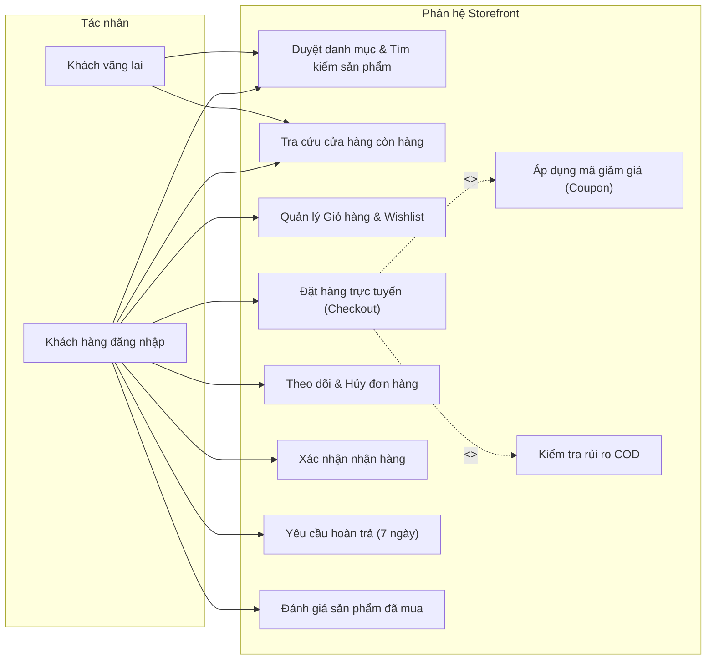
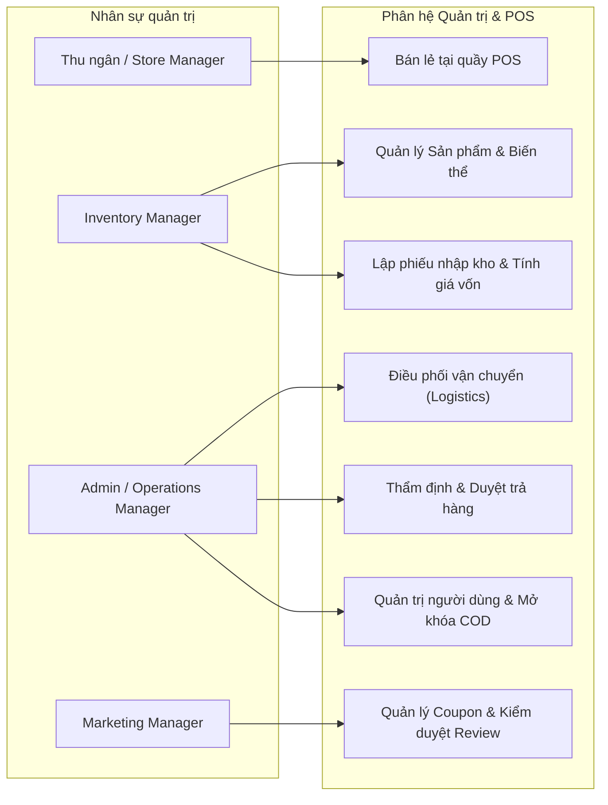
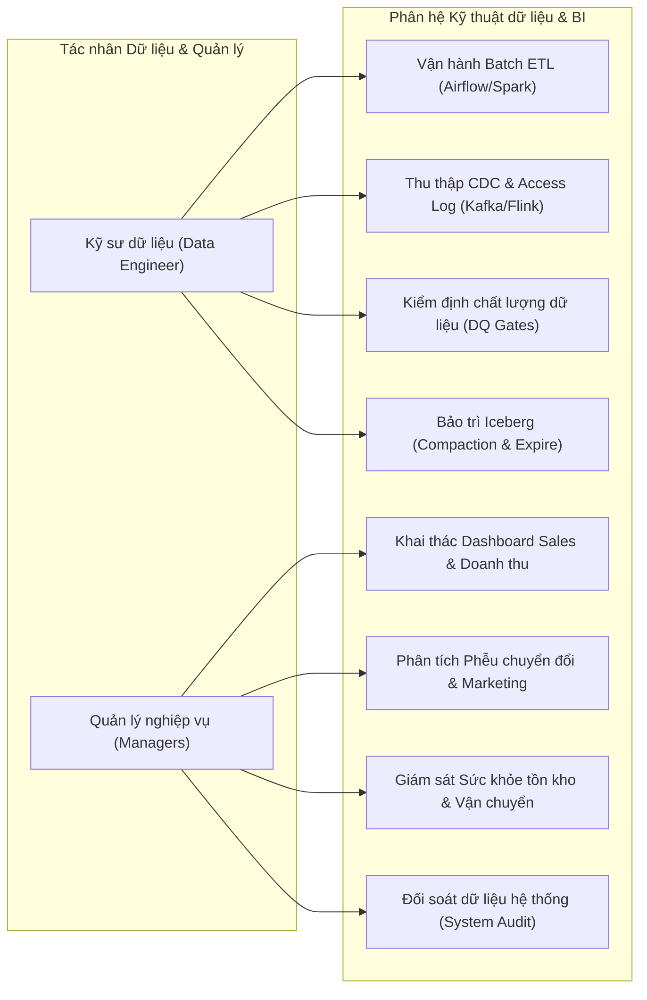
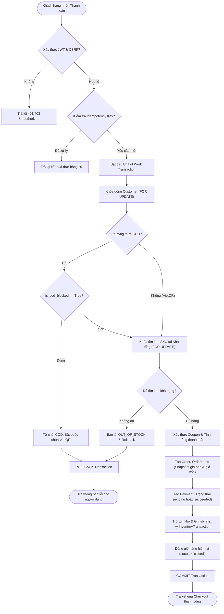
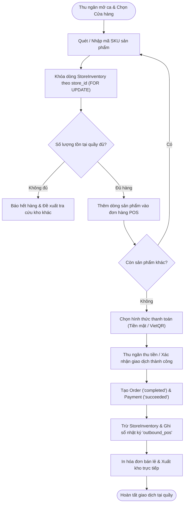
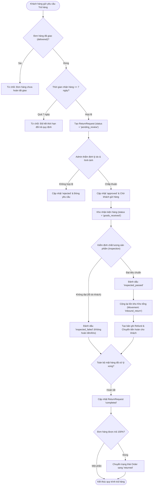
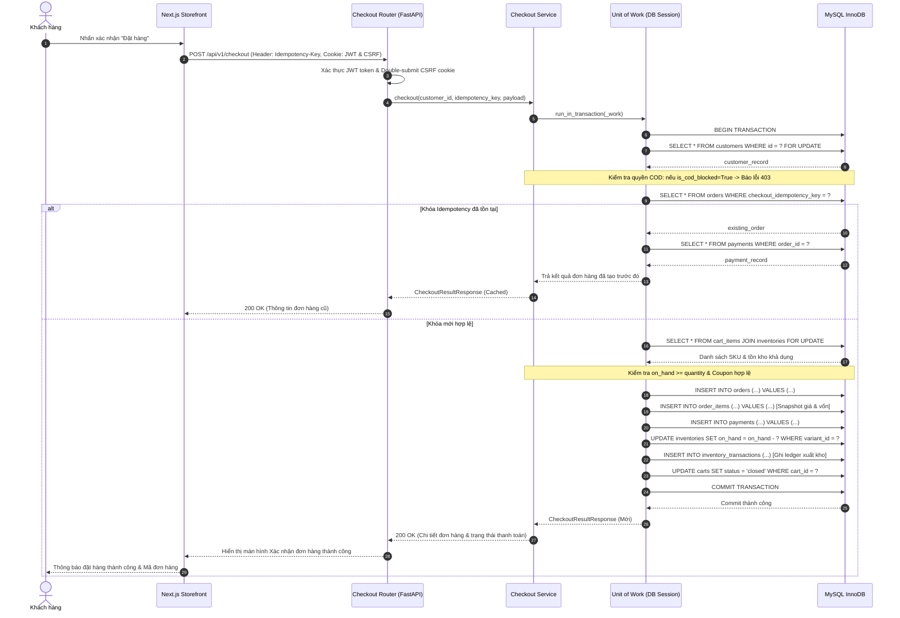
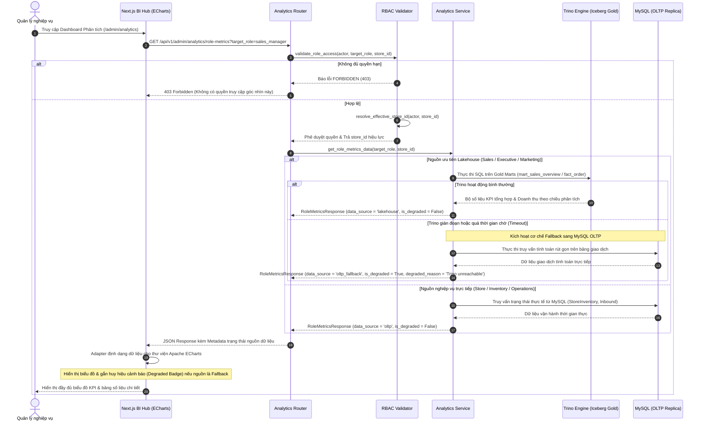

# **CHƯƠNG 2. CƠ SỞ LÝ THUYẾT VÀ CÔNG NGHỆ SỬ DỤNG**

## **2.1. Tổng quan về thương mại điện tử và bán hàng đa kênh**

### **2.1.1. Mô hình thương mại điện tử và bán hàng đa kênh**

Thương mại điện tử (TMĐT) là hoạt động mua bán hàng hóa, dịch vụ mà quá trình đặt hàng được thực hiện qua phương tiện điện tử, trong khi khâu thanh toán và giao nhận có thể diễn ra trực tuyến hoặc ngoại tuyến [1]. Trong đó, mô hình B2C (Business-to-Consumer) cho phép doanh nghiệp phân phối sản phẩm trực tiếp đến người tiêu dùng qua website và các nền tảng số.

Khi mở rộng sang bán hàng đa kênh (Multichannel Retailing) kết hợp giữa website và cửa hàng vật lý, việc quản lý dữ liệu phân tán ở từng kênh riêng lẻ dễ dẫn đến sai lệch tồn kho và gây khó khăn khi tổng hợp doanh thu. Để khắc phục, đồ án này tích hợp kênh bán hàng trực tuyến (Storefront) và hệ thống bán hàng tại quầy (POS) trên cùng một hệ thống Backend và cơ sở dữ liệu giao dịch. Kiến trúc hợp nhất này đảm bảo đồng bộ dữ liệu sản phẩm, giá bán, tồn kho và khách hàng theo quy tắc nghiệp vụ chung, đồng thời chuẩn hóa nguồn dữ liệu giao dịch và hành vi để dễ dàng đối chiếu hiệu quả kinh doanh giữa các kênh trên cùng một hệ quy chiếu chỉ số.

### **2.1.2. Quy trình quản lý bán hàng, đơn hàng và tồn kho**

Dù khác biệt về giao diện và luồng tương tác giữa khách hàng đặt trực tuyến và nhân viên thu ngân tại quầy, cả hai kênh đều chia sẻ chung các nghiệp vụ cốt lõi: kiểm tra tính hợp lệ của giá bán, xác nhận tồn kho khả dụng và cập nhật trạng thái đơn hàng theo quy chuẩn thống nhất.

Về quản lý trạng thái, vòng đời đơn hàng được định nghĩa chặt chẽ qua các giai đoạn (*mới tạo, đã xác nhận, đang xử lý, đang giao, hoàn thành, đã hủy*) và phân tách độc lập thành ba luồng trạng thái: **đơn hàng, giao nhận và thanh toán**. Việc tách biệt này—đặc biệt với phương thức thanh toán khi nhận hàng (COD) chờ đối soát tiền thu hộ hoặc khi phát sinh hủy đơn, giao thất bại, đổi trả—giúp hệ thống tránh ghi nhận doanh thu hay hoàn tiền sai thời điểm, đảm bảo độ chính xác cho báo cáo vận hành.

Về dữ liệu giao dịch và kiểm soát tồn kho, tổng giá trị đơn hàng (đơn giá, số lượng, chiết khấu, phí vận chuyển) phải được tính toán và lưu cố định (snapshot) tại bảng chi tiết đơn hàng ngay thời điểm xác nhận mua để bảo toàn lịch sử khi giá niêm yết thay đổi. Song song đó, để ngăn chặn tình trạng bán vượt số lượng (overselling) khi có giao dịch đồng thời, tồn kho được bóc tách thành ba đại lượng: *số lượng thực tế trong kho (on-hand)*, *số lượng đang tạm giữ (reserved)* và *số lượng khả dụng (available)*, được cập nhật đồng bộ xuyên suốt mọi tác vụ thanh toán, hủy đơn và nhập kho.

### **2.1.3. Vai trò của phân tích dữ liệu trong hoạt động kinh doanh**

Dữ liệu phát sinh từ đơn hàng, sản phẩm, tồn kho và hành vi tương tác trên website là đầu vào quan trọng để nhận diện xu hướng tiêu thụ, xác định nhóm hàng bán chạy hoặc tồn đọng và đánh giá hành trình mua sắm của khách hàng. Do cơ sở dữ liệu giao dịch (OLTP) được tối ưu cho các tác vụ đọc/ghi tức thời thay vì truy vấn tổng hợp lớn, việc đồng bộ dữ liệu sang một nền tảng phân tích chuyên biệt (OLAP) là yêu cầu tất yếu nhằm giảm tải cho hệ thống vận hành chính và tạo bước đệm để làm sạch, chuẩn hóa chỉ số trước khi trực quan hóa.

Về phương pháp tiếp cận, khai thác dữ liệu gồm ba cấp độ: *phân tích mô tả (Descriptive Analytics)* làm rõ những gì đã diễn ra; *phân tích chẩn đoán (Diagnostic Analytics)* tìm hiểu nguyên nhân gốc rễ; và *phân tích dự báo (Predictive Analytics)* ứng dụng học máy. Trong phạm vi đồ án, hệ thống tập trung vào phân tích mô tả và bước đầu hỗ trợ phân tích chẩn đoán nhằm phát hiện sớm các điểm bất thường. Để kết quả phân tích có giá trị đối chiếu giữa kênh trực tuyến và tại quầy, hệ thống thiết lập tầng ngữ nghĩa thống nhất (Single Source of Truth), quy chuẩn hóa các chiều dữ liệu và độ đo cốt lõi trước khi xây dựng Dashboard.

### **2.1.4. Hệ thống chỉ số KPI trong thương mại điện tử**

KPI (Key Performance Indicator) là chỉ số đo lường mức độ đạt mục tiêu kinh doanh và vận hành, bao gồm các nhóm chính: bán hàng (doanh thu, số đơn, giá trị đơn trung bình), vận hành (đơn hủy, giao thất bại, đổi trả), tồn kho và hành vi người dùng (lượt xem, thêm giỏ hàng, chuyển đổi).

*Bảng 2.1. Một số KPI tiêu biểu trong hệ thống thương mại điện tử*

| Chỉ số | Cách xác định |
| :---- | :---- |
| AOV | Tổng giá trị đơn hợp lệ / Số đơn hợp lệ |
| Tỷ lệ hủy đơn | Số đơn bị hủy / Tổng số đơn thuộc phạm vi đánh giá $\times 100\%$ |
| Tỷ lệ chuyển đổi | Số phiên có phát sinh đơn / Tổng số phiên hợp lệ $\times 100\%$ |
| Tỷ lệ trả hàng | Số đơn có phát sinh trả hàng / Số đơn đủ điều kiện đánh giá $\times 100\%$ |

Mỗi KPI cần được quy định thống nhất về nguồn dữ liệu, khoảng thời gian, điều kiện lọc và lập thành danh mục chuẩn để sử dụng xuyên suốt trong thiết kế Data Mart và kiểm thử:
- **Quy tắc tính toán:** Số lượng đơn hàng phải đếm theo mã đơn duy nhất thay vì số dòng sản phẩm chi tiết; doanh thu cần phân biệt rõ giữa giá trị đặt hàng với doanh thu đã hoàn tất (sau khi tính phí vận chuyển, chiết khấu, hoàn trả); chỉ số hành vi cần xác định rõ cách gom phiên truy cập, loại trừ truy cập nội bộ và khử sự kiện trùng lặp.
- **Chu kỳ cập nhật:** Các KPI có độ trễ khác nhau (số đơn đặt hàng ghi nhận tức thời, nhưng doanh thu hoàn thành hoặc tỷ lệ trả hàng phụ thuộc vào diễn biến nghiệp vụ tiếp theo). Do đó, Dashboard cần công bố rõ mốc thời gian cập nhật để người dùng hiểu đúng độ mới của số liệu.

## **2.2. Kiến trúc và công nghệ phát triển hệ thống thương mại điện tử**

### **2.2.1. Kiến trúc Web Client–Server và REST API (Next.js, React, FastAPI)**

Kiến trúc Client–Server phân tách độc lập giữa tầng giao diện người dùng (Frontend) và tầng xử lý nghiệp vụ (Backend), giao tiếp qua REST API dựa trên định danh tài nguyên và các phương thức HTTP tiêu chuẩn (GET, POST, PUT, PATCH, DELETE). Trong đồ án này, Frontend sử dụng thư viện **React** kết hợp framework **Next.js** để xây dựng giao diện dựa trên các thành phần (components) tái sử dụng, tối ưu hóa định tuyến và kết xuất (rendering) cho cả ba phân hệ: Storefront, Admin và POS [2]. Phía máy chủ sử dụng **FastAPI** (Python) để xây dựng REST API hiệu năng cao, tự động kiểm tra dữ liệu đầu vào (validation), khởi tạo tài liệu chuẩn OpenAPI và đảm nhận toàn bộ nghiệp vụ xác thực, sản phẩm, đơn hàng, tồn kho và giao vận [3].

Trong kiến trúc phân lớp, Frontend tập trung thu thập tương tác và hiển thị trạng thái, còn Backend đóng vai trò chốt chặn bảo mật và thực thi logic cốt lõi. Khi đặt hàng, Client chỉ gửi định danh sản phẩm và số lượng; Backend tự truy vấn kiểm chứng lại đơn giá hiện hành, tồn kho khả dụng và quyền truy cập để đảm bảo tính toàn vẹn cho cả Storefront và POS. Ngoài ra, API được thiết kế tuân thủ chuẩn mã trạng thái HTTP, ẩn cấu trúc nội bộ khi báo lỗi, áp dụng cơ chế chống lặp yêu cầu (idempotency) cho các tác vụ nhạy cảm (khởi tạo đơn hàng, thanh toán) và hỗ trợ xử lý bất đồng bộ cho các tiến trình tốn thời gian.

### **2.2.2. Cơ sở dữ liệu giao dịch OLTP (MySQL, SQLAlchemy)**

Hệ thống xử lý giao dịch trực tuyến (OLTP) phục vụ các tác vụ tần suất cao, đòi hỏi phản hồi tức thời và đảm bảo tính nhất quán dữ liệu theo bốn thuộc tính ACID (Tính nguyên tử, Tính nhất quán, Tính cô lập và Tính bền vững). Đồ án lựa chọn hệ quản trị cơ sở dữ liệu **MySQL** với bộ máy lưu trữ InnoDB nhằm tận dụng khả năng quản lý giao dịch (transaction), khóa cấp độ dòng (row-level locking) và kiểm soát khóa ngoại [4]. Ở tầng ứng dụng Python, thư viện **SQLAlchemy** cung cấp cơ chế ánh xạ đối tượng - quan hệ (ORM) và quản lý vòng đời phiên làm việc (Session) [5].

Lược đồ OLTP áp dụng các dạng chuẩn hóa (Normalization) như tách bảng đơn hàng và chi tiết đơn hàng nhằm triệt tiêu dư thừa dữ liệu và bảo vệ toàn vẹn tham chiếu. Tuy nhiên, cấu trúc phân mảnh này khiến các truy vấn báo cáo đa chiều phải thực hiện nhiều phép kết nối (JOIN) và tổng hợp phức tạp, đòi hỏi phải sao chép dữ liệu sang kiến trúc Lakehouse để tách biệt tải phân tích khỏi giao dịch thời gian thực. Bên cạnh đó, để ngăn chặn xung đột khi nhiều giao dịch cùng đặt mua sản phẩm cuối cùng trong kho (race condition), hệ thống kết hợp các ràng buộc toàn vẹn (tồn kho không âm) với cơ chế khóa bản ghi và quản lý ngữ cảnh giao dịch (Commit/Rollback) chặt chẽ ở tầng ứng dụng [4], [5].

### **2.2.3. Xác thực, phân quyền và bảo mật hệ thống**

Hệ thống tách biệt rõ giữa xác thực danh tính người dùng (Authentication) và phân quyền thao tác (Authorization) dựa trên mô hình kiểm soát truy cập theo vai trò (RBAC) cho bốn nhóm tác nhân: khách hàng, thu ngân POS, quản lý cửa hàng và quản trị viên hệ thống.

Tuân thủ khuyến nghị bảo mật API của OWASP, mọi cơ chế kiểm soát truy cập đều được thực thi tại Backend kết hợp kiểm soát quyền sở hữu ở cấp độ bản ghi (Object-level Authorization) và phạm vi nghiệp vụ [6]. Cụ thể, nhân viên quản lý chỉ xem được báo cáo doanh thu thuộc chi nhánh mình phụ trách, và khách hàng chỉ truy xuất được thông tin đơn hàng thuộc tài khoản của chính mình.

Về bảo mật dữ liệu và quyền riêng tư (Data Privacy), mật khẩu người dùng bắt buộc phải băm (hash) một chiều an toàn tại cơ sở dữ liệu nguồn. Trước khi trích xuất dữ liệu sang tầng phân tích Lakehouse hoặc ghi nhận nhật ký (Logging), hệ thống lọc bỏ hoàn toàn các trường nhạy cảm (chuỗi mật khẩu băm, mã khôi phục, Access Token) và cân nhắc áp dụng kỹ thuật ẩn danh hóa (Anonymization) hoặc giả danh hóa (Pseudonymization) đối với thông tin định danh cá nhân (PII).

## **2.3. Kiến trúc và công nghệ lưu trữ Data Lakehouse**

### **2.3.1. Tổng quan về Data Lakehouse**

Khác với hệ thống OLTP tối ưu cho cập nhật đơn lẻ, các hệ thống phân tích (OLAP) ưu tiên hiệu năng đọc và tổng hợp trên tập dữ liệu lớn. Kế thừa ưu điểm của Kho dữ liệu (Data Warehouse) và Hồ dữ liệu (Data Lake), kiến trúc **Data Lakehouse** kết hợp không gian lưu trữ mở, chi phí thấp của Data Lake với khả năng quản trị siêu dữ liệu, đảm bảo toàn vẹn giao dịch (ACID) và hiệu năng truy vấn mạnh mẽ của Data Warehouse thông qua các định dạng bảng mở (Open Table Format) [7].

Trong đồ án, việc lựa chọn Data Lakehouse xuất phát từ bài toán tích hợp các nguồn dữ liệu không đồng nhất (heterogeneous data): dữ liệu tác nghiệp từ MySQL mang cấu trúc bảng quan hệ cố định; bản tin bắt thay đổi dữ liệu (CDC) có cấu trúc lồng nhau (nested) chứa trạng thái trước/sau cập nhật kèm siêu dữ liệu giao dịch; và nhật ký truy cập (Access Log) ghi nhận luồng hành vi người dùng ở dạng bán cấu trúc (semi-structured). Lakehouse cho phép thu thập nguyên bản toàn bộ các nguồn dữ liệu này về một nền tảng lưu trữ vật lý thống nhất, sau đó làm sạch và chuẩn hóa theo phân lớp để phục vụ báo cáo thông minh (BI), giúp giải phóng OLTP khỏi các truy vấn nặng và cho phép nhiều công cụ tính toán cùng khai thác chung một định dạng bảng mà không cần nhân bản dữ liệu.

### **2.3.2. Kiến trúc dữ liệu Landing – Bronze – Silver – Gold**

Dữ liệu trong Lakehouse được tổ chức theo bốn tầng phân tách rõ ràng dựa trên mức độ xử lý:
- **Tầng Landing:** Tiếp nhận dữ liệu thô nguyên bản từ nguồn, phục vụ đối chiếu trực tiếp và chạy lại tiến trình khi cần thiết.
- **Tầng Bronze:** Lưu trữ bản ghi nguồn hoặc sự kiện thô kèm hệ thống siêu dữ liệu (thời điểm thu thập, loại thao tác `insert/update/delete`, định danh nguồn), bảo toàn lịch sử sự kiện để truy vết lỗi.
- **Tầng Silver:** Thực hiện kiểm tra tính hợp lệ, làm sạch dữ liệu bẩn, khử trùng lặp, chuẩn hóa định dạng và hợp nhất các nguồn dữ liệu phân tán.
- **Tầng Gold:** Xây dựng mô hình dữ liệu chiều (Dimension, Fact), các cấu trúc Data Mart chuyên biệt và tập dữ liệu tổng hợp sẵn sàng phục vụ tính toán KPI.

Kiến trúc phân tầng giúp truy vết nguồn gốc dữ liệu (data lineage) tường minh và cô lập phạm vi ảnh hưởng khi gặp sự cố: nếu phát hiện logic tính KPI sai, hệ thống chỉ cần điều chỉnh và chạy lại tầng Gold từ dữ liệu sạch ở Silver mà không phải thu thập lại từ nguồn. Luồng dữ liệu có tính linh hoạt theo đặc thù kỹ thuật (ví dụ luồng CDC có thể ghi trực tiếp vào Bronze), và độ mới (freshness) giữa các tầng sẽ khác nhau do Bronze cập nhật liên tục còn Silver và Gold vận hành theo lịch định kỳ (batch). Ngoài ra, tùy theo mục đích phân tích vòng đời nghiệp vụ (như đơn hàng chuyển từ hoàn thành sang trả hàng), dữ liệu tại Silver và Gold sẽ được định hình theo mô hình lưu trạng thái hiện tại (Current State) hoặc lưu lịch sử sự kiện (History/SCD).

### **2.3.3. Lưu trữ và quản lý dữ liệu (MinIO, Apache Iceberg, Apache Polaris)**

Hạ tầng lưu trữ và quản trị dữ liệu của hệ thống kết hợp đồng bộ ba thành phần công nghệ cốt lõi:
- **MinIO:** Hệ thống lưu trữ đối tượng (Object Storage) tương thích chuẩn S3, chuyên trách lưu trữ vật lý các tệp dữ liệu (Parquet) và siêu dữ liệu [8].
- **Apache Iceberg:** Định dạng bảng mở (Open Table Format) bổ sung tầng siêu dữ liệu lên trên tệp Parquet nhằm quản lý lược đồ, kiểm soát thay đổi đồng thời (`insert/update/delete`) và duy trì cơ chế Snapshot theo dõi phiên bản bảng [9].
- **Apache Polaris:** Đóng vai trò là Iceberg REST Catalog trung tâm, quản lý tập trung thông tin bảng để các engine tính toán phân tán như Spark, Flink và Trino tương tác liền mạch trên cùng một nền tảng [10], [18].

Về vận hành dài hạn, việc ghi dữ liệu liên tục dễ phát sinh nhiều tệp kích thước nhỏ (*small file problem*) làm tăng chi phí lập kế hoạch truy vấn, đồng thời các Snapshot cũ sẽ gây tốn dung lượng lưu trữ. Do đó, kiến trúc Lakehouse cần tích hợp các tác vụ bảo trì định kỳ như gộp tệp (*compaction*) và dọn dẹp phiên bản cũ (*snapshot expiration*) theo chính sách lưu giữ (*retention policy*) hợp lý, vừa tối ưu hiệu năng vừa đảm bảo khả năng khôi phục dữ liệu khi cần.

### **2.3.4. Mô hình dữ liệu phân tích (Dimension, Fact, Data Mart)**

Tại tầng Gold, mô hình dữ liệu chiều (Dimensional Modeling) được áp dụng với cấu trúc hình sao (Star Schema) nhằm tối ưu hóa hiệu năng cho các truy vấn phân tích BI [11]:
- **Bảng chiều (Dimension):** Chứa các thuộc tính mô tả bối cảnh nghiệp vụ (sản phẩm, cửa hàng, kênh bán hàng, thời gian), sử dụng khóa đại diện (Surrogate Keys) và quy định rõ quy tắc xử lý giá trị khuyết (Unknown/Missing Members).
- **Bảng sự thật (Fact):** Lưu trữ các sự kiện giao dịch hoặc đại lượng định lượng đo lường được (số lượng bán, doanh thu, giá trị hoàn trả). Khi thiết kế bảng Fact, việc xác định rõ mức độ chi tiết (Grain)—ví dụ mỗi bản ghi ứng với đúng một dòng sản phẩm trong đơn hàng—là yếu tố tiên quyết để ngăn chặn tình trạng đếm trùng chỉ số.
- **Data Mart:** Tập hợp các bảng Fact và Dimension được thiết kế hướng đến một nhu cầu phân tích chuyên biệt như bán hàng, tồn kho hoặc hành vi khách hàng.

Bên cạnh giao dịch tài chính, hành vi tương tác trực tuyến trên Storefront (xem sản phẩm, thêm giỏ hàng) được tổ chức thành bảng Fact riêng biệt với mức hạt (Grain) ứng với từng sự kiện. Hệ thống tuyệt đối không kết nối (JOIN) trực tiếp hai bảng Fact khác Grain để tránh làm nhân bản sai lệch số liệu, mà thực hiện đối chiếu thông qua các bảng chiều dùng chung (Conformed Dimensions) như thời gian, sản phẩm và kênh bán hàng.

## **2.4. Công nghệ thu thập và xử lý dữ liệu**

### **2.4.1. Thu thập và xử lý dữ liệu theo lô (Apache Spark)**

Xử lý theo lô (Batch Processing) vận hành trên tập dữ liệu quy mô lớn theo lịch định kỳ. Trong đồ án, **Apache Spark** đóng vai trò là engine tính toán phân tán chủ lực cho toàn bộ luồng Batch nhờ hệ thống API DataFrame, Spark SQL và khả năng kết nối cơ sở dữ liệu quan hệ qua giao thức JDBC [12]. Spark đảm nhận việc trích xuất định kỳ từ MySQL, làm sạch và biến đổi dữ liệu từ tầng Bronze sang Silver, đồng thời xây dựng các bảng Dimension, Fact và Data Mart tại tầng Gold.

Một pipeline Batch chuẩn gồm các bước: đọc dữ liệu nguồn, kiểm tra lược đồ (schema validation), thực hiện các phép biến đổi nghiệp vụ (kết nối bảng đơn hàng và chi tiết, chuẩn hóa mã trạng thái, tính toán chỉ số tài chính) và ghi kết quả theo cơ chế lũy đẳng (idempotent writes) nhằm ngăn chặn trùng lặp bản ghi khi chạy lại tiến trình.

Khi trích xuất dữ liệu từ MySQL, phương pháp đọc toàn bộ bảng (Full Load) chỉ phù hợp với các bảng danh mục nhỏ. Đối với các bảng giao dịch lớn, hệ thống áp dụng phương pháp trích xuất gia tăng (Incremental Load) dựa trên cột thời gian `updated_at` hoặc khóa tuần tự kết hợp cơ chế lưu mốc thời gian đã xử lý (Watermark). Chiến lược này đi kèm phương án xử lý dữ liệu đến muộn (late-arriving data) và kịch bản đối soát định kỳ nhằm nhận diện các thao tác xóa vật lý (hard delete) tại nguồn.

### **2.4.2. Thu thập dữ liệu thay đổi CDC + Access Log (Debezium, Kafka, Flink)**

Để thu thập dữ liệu thời gian thực hướng vào tầng Bronze của Lakehouse, hệ thống kết hợp **Debezium** (chụp ảnh ban đầu và đọc MySQL binlog để bắt thay đổi dữ liệu - CDC) [13], **Apache Kafka** (truyền tải sự kiện phân tán theo Topic và đảm bảo thứ tự trong từng Partition) [14] cùng **Apache Flink** (xử lý luồng có trạng thái và khôi phục lỗi dựa trên Checkpoint) [15] qua hai luồng chính:
- **Luồng CDC ($\text{MySQL} \rightarrow \text{Debezium} \rightarrow \text{Kafka} \rightarrow \text{Flink} \rightarrow \text{Iceberg Bronze}$):** Phản ánh các biến động `INSERT`, `UPDATE`, `DELETE` từ cơ sở dữ liệu. Khi xử lý tại Bronze, hệ thống phải phân biệt rõ sự kiện từ tiến trình đọc Snapshot ban đầu với sự kiện thay đổi thực tế từ binlog để tránh hiểu nhầm thành hai giao dịch độc lập, đồng thời giám sát chặt chẽ độ trễ (binlog lag) và thời gian lưu trữ binlog của MySQL [13].
- **Luồng Access Log ($\text{App} \rightarrow \text{Kafka} \rightarrow \text{Flink} \rightarrow \text{Iceberg Bronze}$):** Ghi nhận sự kiện tương tác người dùng (`view_product`, `add_to_cart`) với cấu trúc chuẩn hóa gồm tên hành động, mốc thời gian, `session_id` và ngữ cảnh đi kèm. Do dữ liệu từ phía trình duyệt (Client-side) có nguy cơ thất lạc hoặc gửi lặp, chúng chỉ phục vụ phân tích hành vi; mọi chỉ số doanh thu bắt buộc phải đối chiếu từ bản ghi giao dịch chính thức tại MySQL.

Trên Kafka, các Topic được gán khóa bản ghi (record key) theo thực thể nghiệp vụ (đơn hàng, sản phẩm) để định tuyến vào cùng một Partition nhằm bảo toàn thứ tự xử lý [14]. Khi tính toán trạng thái tại tầng Silver, hệ thống tiếp tục tích hợp cơ chế chống trùng lặp (de-duplication), loại bỏ thông tin nhạy cảm và sắp xếp lại chuỗi thay đổi dựa trên khóa nghiệp vụ cùng siêu dữ liệu thời gian nguồn.

### **2.4.3. Điều phối Pipeline (Apache Airflow)**

**Apache Airflow** là công cụ điều phối luồng công việc (workflow orchestration) cho phép mô hình hóa chuỗi tác vụ phụ thuộc dưới dạng Đồ thị có hướng không có chu trình (DAG), hỗ trợ lập lịch thực thi, giám sát trạng thái và tự động chạy lại khi gặp sự cố [16].

Trong đồ án, Airflow đóng vai trò điều phối trung tâm cho các pipeline Batch (gọi tác vụ Spark) và kiểm tra chất lượng dữ liệu theo trình tự: kích hoạt trích xuất Batch $\rightarrow$ chờ dữ liệu tại Bronze ghi nhận thành công $\rightarrow$ gọi Spark làm sạch dữ liệu lên Silver $\rightarrow$ xây dựng mô hình tầng Gold $\rightarrow$ thực thi tập lệnh kiểm tra chất lượng. Để cơ chế tự động chạy lại hoạt động an toàn, mọi tác vụ đều phải được thiết kế đạt tính lũy đẳng (idempotent) [16]. Ngoài ra, các DAG cần tích hợp cơ chế kiểm tra điều kiện sẵn sàng của dữ liệu nguồn (sensor/check) thay vì chỉ dựa vào đồng hồ thời gian thực, đồng thời cân đối lịch chạy hợp lý để tối ưu tài nguyên khi các dịch vụ cùng chia sẻ hạ tầng container Docker.

### **2.4.4. Kiểm soát chất lượng dữ liệu và xử lý lỗi**

Chất lượng dữ liệu (Data Quality) trong hệ thống được đánh giá qua bốn tiêu chí: tính đầy đủ (completeness), tính hợp lệ (validity), tính nhất quán (consistency) và tính kịp thời (timeliness) [17], được phân bổ kiểm soát theo từng tầng của Lakehouse:
- **Tầng Bronze:** Kiểm tra cấu trúc lược đồ và khả năng đọc bản ghi thô.
- **Tầng Silver:** Kết hợp kiểm tra kỹ thuật (kiểu dữ liệu, trường bắt buộc `not-null`, tính duy nhất của khóa, định dạng thời gian) và kiểm tra nghiệp vụ (số lượng bán $> 0$, tổng chi tiết khớp tổng đơn hàng, mã trạng thái hợp lệ).
- **Tầng Gold:** Đối chiếu chéo kết quả tổng hợp với dữ liệu nền tảng trên cùng một mốc thời gian, công thức KPI và quy tắc lọc thống nhất.

Các bản ghi không đạt chuẩn sẽ được điều hướng vào vùng cách ly (Quarantine) kèm nguyên nhân chi tiết để gỡ lỗi, hoặc kích hoạt cảnh báo chặn xuất bản dữ liệu lên tầng Gold nếu vi phạm ngưỡng nghiêm trọng [17]. Quy trình đối soát cũng xét đến sự khác biệt ngữ cảnh giữa các tầng (ví dụ: số bản ghi trạng thái hiện tại ở Silver ít hơn tổng sự kiện CDC ở Bronze, và doanh thu hoàn tất ở Gold đã loại trừ đơn hủy/hoàn trả so với tổng tiền đặt hàng ban đầu), đồng thời lưu vết kết quả kiểm thử theo từng lần chạy để dễ dàng truy tìm nguyên nhân sai lệch.

## **2.5. Công nghệ phân tích và trực quan hóa dữ liệu**

### **2.5.1. Truy vấn dữ liệu phân tích (Apache Trino)**

**Apache Trino** là công cụ truy vấn SQL phân tán hiệu năng cao, cho phép đọc và thực thi truy vấn độ trễ thấp trực tiếp trên các bảng dữ liệu tầng Gold thông qua Iceberg Connector, Polaris Catalog và hạ tầng lưu trữ MinIO [18].

Trong kiến trúc hệ thống, ứng dụng Frontend không kết nối trực tiếp đến Trino mà giao tiếp qua lớp Backend API phân tích trung gian. Khi nhận yêu cầu báo cáo, Backend tiến hành xác thực quyền hạn người dùng, kiểm tra tham số đầu vào, biên dịch và gửi câu lệnh SQL tới Trino, sau đó chuẩn hóa kết quả trả về thành cấu trúc JSON [18]. Để tối ưu hiệu năng và chi phí tính toán khi nhiều người dùng truy cập đồng thời, các truy vấn phục vụ Dashboard luôn được giới hạn theo phạm vi thời gian cần thiết và khai thác trực tiếp trên các bảng tổng hợp sẵn (pre-aggregated tables / Data Mart) tại tầng Gold nhằm hạn chế tối đa các phép kết nối bảng (JOIN) phức tạp.

### **2.5.2. Trực quan hóa dữ liệu và thiết kế Dashboard (Apache ECharts)**

Hệ thống sử dụng **Apache ECharts**—thư viện trực quan hóa JavaScript hỗ trợ tương tác mạnh mẽ và tích hợp linh hoạt với React/Next.js—để hiển thị dữ liệu từ Backend API thành các Dashboard quản trị [20]. Thiết kế bố cục Dashboard bám sát nhu cầu từng vai trò, đi từ tổng quan đến chi tiết và chọn loại biểu đồ đúng mục đích: đặt các thẻ KPI tổng quan ở phần đầu, tiếp theo là biểu đồ đường (line chart) thể hiện xu hướng theo thời gian, biểu đồ cột (bar chart) so sánh theo sản phẩm/cửa hàng/kênh bán, và bảng dữ liệu (table) khi cần tra cứu chi tiết [19].

Giao diện Dashboard cung cấp các bộ lọc đồng nhất có giá trị mặc định rõ ràng, hiển thị trạng thái rỗng (empty state) khi không có dữ liệu thay vì số $0$ thiếu ngữ cảnh, đồng thời công bố rõ mốc thời gian cập nhật để người dùng đánh giá đúng độ mới của KPI [19]. Quá trình triển khai BI luôn thực hiện kiểm thử song song giữa cấu hình biểu đồ, quy tắc lọc, đơn vị hiển thị, phân quyền phía Server và độ chính xác của số liệu gốc tại tầng Gold [20].

# **CHƯƠNG 3. PHÂN TÍCH VÀ THIẾT KẾ HỆ THỐNG**

## **3.1. Phân tích yêu cầu hệ thống**

### **3.1.1. Bối cảnh và phát biểu bài toán**

Hệ thống được thiết kế và xây dựng phục vụ doanh nghiệp bán lẻ thời trang D&K hoạt động theo mô hình bán hàng đa kênh (Omnichannel), kết hợp giữa kênh trực tuyến (Web Storefront) và chuỗi cửa hàng vật lý (POS) [1]. Hoạt động kinh doanh phát sinh khối lượng lớn dữ liệu giao dịch trải rộng trên 28 bảng quan hệ (người dùng, danh mục đa cấp, sản phẩm đa biến thể, kho bãi đa điểm, đơn hàng, hóa đơn POS, thanh toán, vận chuyển, đổi trả, khuyến mãi và đánh giá).

Qua quá trình khảo sát thực tế và phân tích vận hành, hệ thống giải quyết ba bài toán cốt lõi sau:
1. **Tránh suy giảm hiệu năng giao dịch do truy vấn phân tích (OLTP Workload Isolation)**: Việc tính toán các chỉ số kinh doanh (KPI) phức tạp trực tiếp trên cơ sở dữ liệu giao dịch MySQL InnoDB gây nghẽn tài nguyên, gia tăng xung đột khóa dòng/bảng (locking) và làm chậm các thao tác nghiệp vụ thiết yếu của khách hàng lẫn thu ngân [4].
2. **Hợp nhất dữ liệu đa cấu trúc và phân mảnh (Eliminating Data Silos)**: Doanh nghiệp cần phân tích song song giữa dữ liệu giao dịch có cấu trúc chặt chẽ từ cơ sở dữ liệu quan hệ và dữ liệu hành vi người dùng (clickstream, access log) có cấu trúc bán cấu trúc (JSON) với thông lượng lớn từ các dịch vụ web.
3. **Chuẩn hóa tầng dữ liệu ngữ nghĩa (Unified Semantic Layer)**: Các quy tắc nghiệp vụ đặc thù—như tính giá trị tồn kho theo phương pháp bình quân gia quyền di động, kiểm soát rủi ro giao hàng thu tiền hộ (COD), chính sách hoàn trả trong 7 ngày, hay phễu chuyển đổi giỏ hàng—cần được tập trung hóa vào một nguồn chân lý dữ liệu duy nhất (Single Source of Truth).

Để giải quyết triệt để các thách thức trên, giải pháp đặt ra là xây dựng một nền tảng dữ liệu mở (Data Lakehouse) theo kiến trúc Medallion (Landing $\rightarrow$ Bronze $\rightarrow$ Silver $\rightarrow$ Gold) trên nền tảng Apache Iceberg và Apache Polaris Catalog [7], [9], [10]. Nền tảng vừa duy trì vận hành ổn định hệ thống ứng dụng bán lẻ trực tuyến và tại quầy (FastAPI, Next.js, MySQL), vừa xử lý dữ liệu lớn theo luồng (Kafka, Flink) và theo mẻ (Spark, Airflow), phục vụ báo cáo BI qua Trino và ECharts [18], [20].

### **3.1.2. Các tác nhân và phạm vi hệ thống**

#### **a. Các tác nhân hệ thống (Actors)**
Hệ thống xác định 4 nhóm tác nhân chính tham gia tương tác:
* **Khách hàng (Customer)**: Bao gồm khách vãng lai (*Guest*) và khách hàng đã đăng ký/đăng nhập (*Authenticated Customer*). Thực hiện duyệt danh mục sản phẩm, tìm kiếm, quản lý giỏ hàng, đặt hàng trực tuyến, thanh toán, theo dõi vận đơn và gửi yêu cầu hoàn trả.
* **Thu ngân (POS Cashier)**: Nhân viên tại quầy cửa hàng, thực hiện tra cứu sản phẩm, chọn cửa hàng phục vụ, tạo đơn bán lẻ trực tiếp, áp dụng khuyến mãi, ghi nhận thanh toán và in/xuất hóa đơn bán lẻ.
* **Người quản lý nghiệp vụ (Business Managers)**: Tiếp cận các báo cáo BI và công cụ vận hành theo cơ chế phân quyền dựa trên vai trò (RBAC):
  * *Quản lý cửa hàng (`store_manager`)*: Theo dõi doanh thu, dòng tiền ca làm việc và nhân viên tại cửa hàng phụ trách.
  * *Quản lý kinh doanh (`sales_manager`)*: Giám sát toàn diện doanh thu đa kênh, tỷ lệ hủy/boom đơn và hiệu suất đơn hàng.
  * *Quản lý tiếp thị (`marketing_manager`)*: Phân tích lưu lượng truy cập, phễu chuyển đổi giỏ hàng và hiệu quả của các chương trình khuyến mãi.
  * *Quản lý kho (`inventory_manager`)*: Giám sát biến động nhập - xuất - chuyển kho, định giá trị vốn hàng tồn và cảnh báo rủi ro hết hàng.
  * *Quản lý vận hành (`operations_manager`)*: Điều phối quy trình đóng gói, giao vận và thẩm định xử lý hoàn trả hàng.
  * *Quản trị viên (`admin` / `system_admin`)*: Quản lý tài khoản, cấu hình tham số hệ thống và cấp phát quyền hạn.
* **Kỹ sư dữ liệu / Quản trị hạ tầng (Data Engineer / System Operator)**: Vận hành, điều phối các pipeline dữ liệu (Batch ETL, CDC, Stream Ingestion), giám sát chất lượng dữ liệu và sức khỏe hạ tầng.

#### **b. Phạm vi hệ thống (System Scope)**
* **Trong phạm vi (In-Scope)**:
  * Xây dựng trọn vẹn ứng dụng thương mại điện tử (Web Storefront) và phân hệ bán hàng tại quầy (POS) với 28 bảng cơ sở dữ liệu quan hệ chuẩn hóa trên MySQL InnoDB [4].
  * Vận hành mô hình tồn kho 2 cấp (kho tổng trung tâm và chuỗi cửa hàng vật lý) áp dụng công thức giá vốn bình quân gia quyền di động (Moving Weighted Average Cost) cho từng biến thể:
    $$C_{new} = \frac{Q_{current} \times C_{current} + Q_{incoming} \times P_{incoming}}{Q_{current} + Q_{incoming}}$$
  * Kiểm soát rủi ro thanh toán khi nhận hàng (COD): Tự động đánh dấu rủi ro và chặn phương thức COD nếu khách hàng có lịch sử từ chối nhận hàng (boom đơn) từ 3 lần trở lên ($count_{boom} \ge 3$).
  * Quy định thời hạn yêu cầu hoàn trả hàng trực tuyến hợp lệ trong vòng 7 ngày kể từ thời điểm đơn hàng chuyển sang trạng thái đã giao thành công (`delivered`).
  * Xây dựng nền tảng Lakehouse: Thu thập 27 bảng dữ liệu nghiệp vụ (loại trừ bảng chứa thông tin nhạy cảm `customer_credentials`), xử lý luồng nhật ký truy cập (Access Log); xây dựng 6 conformed dimensions, 5 core facts, 4 OLTP data marts, 3 access log data marts và bộ kiểm tra chất lượng tự động 18 chỉ tiêu theo ISO/IEC 25012 [17].
  * Trực quan hóa dữ liệu Dashboard theo vai trò quản trị qua giao diện Next.js tích hợp thư viện Apache ECharts [2], [20].
* **Ngoài phạm vi (Out-of-Scope)**:
  * Không tích hợp cổng thanh toán thực tế trực tiếp với ngân hàng đối tác (sử dụng cổng thanh toán mô phỏng sandbox/mock payment).
  * Không kết nối trực tiếp với phần cứng máy in nhiệt hoặc máy quét mã vạch chuyên dụng tại điểm bán vật lý.
  * Không triển khai các mô hình Machine Learning gợi ý sản phẩm theo thời gian thực (chỉ tập trung vào phân tích mô tả và chẩn đoán kinh doanh).

### **3.1.3. Yêu cầu chức năng**

Yêu cầu chức năng của hệ thống được phân rã theo 3 phân hệ chủ chốt:

#### **a. Phân hệ ứng dụng giao dịch (E-Commerce & POS Application)**
* **FR-APP-01 (Quản lý sản phẩm & danh mục)**: Quản lý danh mục đa cấp, quản lý thông tin sản phẩm và các biến thể chi tiết (SKU) theo kích thước, màu sắc, giá bán, giá vốn và bộ sưu tập ảnh.
* **FR-APP-02 (Giỏ hàng & Đặt hàng trực tuyến)**: Hỗ trợ giỏ hàng theo phiên và tài khoản; kiểm tra số lượng tồn khả dụng (`available_quantity`); áp dụng phiếu giảm giá hợp lệ; tạo đơn hàng và quản lý chuyển đổi trạng thái đơn theo máy trạng thái hữu hạn.
* **FR-APP-03 (Bán lẻ tại quầy POS)**: Tra cứu nhanh sản phẩm qua mã SKU; tạo đơn hàng tại quầy; tự động trừ tồn kho tức thời tại cửa hàng thực hiện giao dịch; hỗ trợ đa phương thức thanh toán.
* **FR-APP-04 (Quản lý kho hàng & điều chuyển)**: Ghi nhận phiếu nhập kho, xuất kho, điều chuyển hàng giữa kho tổng và các cửa hàng; tự động tính lại giá vốn bình quân gia quyền.
* **FR-APP-05 (Thanh toán & Vận chuyển)**: Tiếp nhận thanh toán COD, chuyển khoản mô phỏng; sinh mã vận đơn và cập nhật tiến trình giao hàng theo từng mốc thời gian.
* **FR-APP-06 (Hoàn trả & Đánh giá)**: Tiếp nhận yêu cầu hoàn trả trong hạn 7 ngày; ghi nhận lý do và bằng chứng hình ảnh; cập nhật hoàn tiền và hoàn kho; cho phép khách hàng đánh giá và bình luận sản phẩm đã mua.
* **FR-APP-07 (Quản trị & Phân quyền)**: Xác thực người dùng bằng JWT; phân quyền truy cập chức năng và dữ liệu theo RBAC [6].

#### **b. Phân hệ kỹ thuật dữ liệu (Data Lakehouse Platform)**
* **FR-DE-01 (Thu thập dữ liệu mẻ - Batch Ingestion)**: Airflow điều phối trích xuất định kỳ dữ liệu từ 27 bảng MySQL sang định dạng Parquet trên MinIO Landing, sau đó nạp vào tầng Bronze Iceberg [8], [9], [16].
* **FR-DE-02 (Thu thập dữ liệu thay đổi - CDC Ingestion)**: Debezium bắt sự kiện thay đổi trên MySQL binlog và chuyển tiếp vào Kafka topics tương ứng [13], [14].
* **FR-DE-03 (Thu thập dữ liệu truy cập - Log Ingestion)**: Ghi nhận sự kiện clickstream/HTTP access log từ Storefront vào Kafka; Flink thực hiện chuẩn hóa và ghi liên tục vào Bronze log table [15].
* **FR-DE-04 (Làm sạch & Chuẩn hóa tầng Silver)**: Khử trùng lặp bản ghi (deduplication); chuẩn hóa định dạng thời gian và tiền tệ; giải mã các trường bán cấu trúc JSON; mã hóa một chiều thông tin định danh cá nhân (PII pseudonymization) [6].
* **FR-DE-05 (Mô hình hóa dữ liệu tầng Gold)**: Xây dựng kho dữ liệu theo mô hình hình sao (Star Schema) gồm 6 bảng chiều (`dim_date`, `dim_customer`, `dim_product`, `dim_store`, `dim_order_status`, `dim_device`) và 5 bảng sự kiện (`fact_order_item`, `fact_inventory_daily_snapshot`, `fact_payment`, `fact_return`, `fact_pageview`) [11].
* **FR-DE-06 (Tổng hợp Data Marts)**: Tổng hợp định kỳ 4 marts phân tích nghiệp vụ (`mart_sales_overview`, `mart_product_performance`, `mart_inventory_health`, `mart_customer_behavior`) và 3 marts phân tích hành vi truy cập (`mart_hourly_traffic`, `mart_cart_funnel`, `mart_top_viewed_products`).
* **FR-DE-07 (Kiểm định chất lượng dữ liệu)**: Tự động thực thi bộ kiểm tra 18 chỉ tiêu chất lượng dữ liệu (Data Quality Checks) về tính đầy đủ, tính duy nhất, tính hợp lệ và tính toàn vẹn tham chiếu trước khi công bố dữ liệu lên Data Marts [17].

#### **c. Phân hệ phân tích và báo cáo (BI & Analytics)**
* **FR-BI-01 (Báo cáo doanh thu & bán hàng)**: Cung cấp các chỉ số doanh thu gộp (Gross Revenue), doanh thu thuần (Net Sales), chiết khấu, số lượng đơn hoàn tất và so sánh hiệu suất giữa kênh Web và POS.
* **FR-BI-02 (Báo cáo hiệu quả sản phẩm)**: Thống kê số lượng bán, doanh thu, lợi nhuận gộp theo từng SKU, danh mục, sản phẩm bán chạy nhất (Top Sellers) và tỷ lệ hủy/trả theo dòng sản phẩm.
* **FR-BI-03 (Báo cáo sức khỏe tồn kho)**: Hiển thị giá trị vốn tồn kho toàn hệ thống, số lượng tồn thực tế, tỷ lệ sẵn sàng bán và đưa ra cảnh báo sớm các mặt hàng dưới ngưỡng an toàn.
* **FR-BI-04 (Báo cáo hành vi truy cập & phễu chuyển đổi)**: Trực quan hóa lượng truy cập theo khung giờ, trang xem nhiều nhất và tỷ lệ chuyển đổi qua từng bước trong phễu mua hàng (Xem sản phẩm $\rightarrow$ Thêm giỏ hàng $\rightarrow$ Bắt đầu thanh toán $\rightarrow$ Đặt hàng thành công).

### **3.1.4. Yêu cầu phi chức năng**

Các yêu cầu phi chức năng được xác lập nhằm đảm bảo chất lượng kỹ thuật, tính ổn định và khả năng vận hành lâu dài của hệ thống:

* **NFR-01: Tính nhất quán và toàn vẹn dữ liệu (Data Consistency & Integrity)**:
  * Hệ thống giao dịch đảm bảo tuân thủ đầy đủ thuộc tính ACID trên công cụ lưu trữ MySQL InnoDB [4].
  * Tầng lưu trữ Data Lakehouse đảm bảo tính bất biến của tệp dữ liệu gốc và hỗ trợ giao dịch ACID ở cấp độ bảng thông qua Apache Iceberg v2 kết hợp Apache Polaris REST Catalog [9], [10].
  * Các pipeline ETL/ELT phải đảm bảo tính chất lũy kế vô hại (Idempotency): kết quả dữ liệu tại tầng Silver và Gold không bị nhân bản hay sai lệch khi thực thi lại một tác vụ nhiều lần trên cùng một khoảng thời gian [16].
* **NFR-02: Tính bảo mật và an toàn thông tin (Security & Privacy)**:
  * Áp dụng xác thực không trạng thái (Stateless Authentication) qua JSON Web Token (JWT) và kiểm soát truy cập dựa trên vai trò (RBAC) cho toàn bộ các API quản trị [6].
  * Cách ly dữ liệu nhạy cảm: Tuyệt đối không trích xuất bảng `customer_credentials` vào nền tảng Data Lakehouse.
  * Các thuộc tính định danh cá nhân (PII) như số điện thoại và email khách hàng phải được băm (hashing với Salt) hoặc ẩn danh hóa trước khi đưa vào các bảng chiều phân tích [6].
* **NFR-03: Hiệu năng và khả năng mở rộng (Performance & Scalability)**:
  * Phản hồi API giao dịch: Thời gian đáp ứng của các API duyệt sản phẩm và tạo đơn hàng đạt ngưỡng $P_{95} \le 200\text{ ms}$ ở tải hoạt động tiêu chuẩn [3].
  * Thời gian phản hồi truy vấn phân tích: Các câu truy vấn báo cáo từ Dashboard thông qua Trino trên các bảng Data Mart tầng Gold đạt thời gian phản hồi dưới $2\text{ giây}$ [18].
  * Tối ưu hóa kích thước tệp: Apache Iceberg duy trì kích thước tệp dữ liệu Parquet mục tiêu trong khoảng $128\text{ MiB} - 256\text{ MiB}$, tránh tình trạng phân mảnh tệp nhỏ (Small Files Problem) làm suy giảm hiệu năng đọc [9].
* **NFR-04: Tính sẵn sàng và khả năng chịu lỗi (Availability & Fault Tolerance)**:
  * Toàn bộ hệ thống (dịch vụ ứng dụng, lưu trữ, xử lý luồng, xử lý mẻ, truy vấn) được container hóa độc lập bằng Docker Compose, có chính sách tự khởi động lại khi gặp sự cố (`restart: unless-stopped` hoặc `on-failure`).
  * Hệ thống xử lý luồng Apache Flink kích hoạt cơ chế kiểm tra điểm (Checkpointing) với chu kỳ $10\text{ giây}$, đảm bảo ngữ nghĩa xử lý chính xác một lần (Exactly-Once Semantics) khi có sự cố ngắt quãng [15].
  * Apache Airflow được cấu hình cơ chế tự động thử lại (retry với exponential backoff) và ghi nhận nhật ký lỗi chi tiết cho từng task [16].
* **NFR-05: Khả năng tương tác và tiêu chuẩn mở (Interoperability & Open Architecture)**:
  * Hệ thống sử dụng các chuẩn công nghệ mở công nghiệp: định dạng bảng mở Apache Iceberg, giao thức REST Catalog của Apache Polaris, định dạng lưu trữ cột Parquet trên giao thức tương thích Amazon S3 (MinIO) [8], [9], [10].
  * Tránh ràng buộc nhà cung cấp (Vendor Lock-in), cho phép các công cụ tính toán khác nhau (Apache Spark, Trino, Apache Flink) cùng chia sẻ một không gian siêu dữ liệu và đọc/ghi dữ liệu đồng thời một cách an toàn [7], [18].

## **3.2. Phân tích chức năng và quy trình nghiệp vụ**

### **3.2.1. Sơ đồ Use Case**

Các ca sử dụng của hệ thống được phân rã theo 3 phân hệ độc lập tương ứng với các nhóm tác nhân đã xác định: Phân hệ Khách hàng (Storefront), Phân hệ Quản trị vận hành & Điểm bán (Admin & POS), và Phân hệ Kỹ thuật dữ liệu & Báo cáo BI (Data Engineering & Analytics) [docs/diagram/02-use-cases.drawio](docs/diagram/02-use-cases.drawio).

#### **a. Phân hệ Khách hàng (Storefront Use Cases)**
Tác nhân Khách vãng lai (*Guest*) và Khách hàng đã đăng nhập (*Authenticated Customer*) tương tác với nền tảng thông qua giao diện Web Storefront [2]:
* **Khách vãng lai**: Duyệt danh mục phân cấp, tìm kiếm sản phẩm theo từ khóa/bộ lọc, xem chi tiết biến thể và bảng giá, tra cứu danh sách cửa hàng còn hàng gần nhất theo khu vực, và xem đánh giá công khai.
* **Khách hàng đã đăng nhập**: Quản lý giỏ hàng và danh sách yêu thích (*Wishlist*); thực hiện đặt hàng trực tuyến (*Checkout*); tra cứu trạng thái đơn hàng và lịch sử mua sắm; xác nhận đã nhận hàng (`delivered` $\rightarrow$ `completed`); gửi yêu cầu hoàn trả/đổi hàng trong thời hạn 7 ngày; viết bài đánh giá kèm điểm số xếp hạng cho từng sản phẩm đã mua.

*Sơ đồ chi tiết: [docs/diagram/uc-storefront.svg](docs/diagram/uc-storefront.svg).*

#### **b. Phân hệ Quản trị & Bán lẻ tại quầy (Admin & POS Use Cases)**
Hệ thống quản trị áp dụng cơ chế kiểm soát truy cập dựa trên vai trò (RBAC) nghiêm ngặt [6]:
* **Thu ngân / Quản lý cửa hàng (`store_manager`)**: Tra cứu sản phẩm theo mã SKU, chọn cửa hàng phục vụ, tạo đơn hàng bán lẻ tại quầy POS, tự động trừ tồn kho khả dụng tại cửa hàng và xuất hóa đơn bán lẻ [4].
* **Quản lý kho (`inventory_manager`)**: Quản lý sản phẩm, danh mục và các biến thể; lập phiếu nhập kho (Inbound Receipt) và kích hoạt tính toán lại giá vốn bình quân gia quyền di động; điều chuyển hàng hóa giữa các kho.
* **Quản trị viên / Quản lý vận hành (`admin` / `operations_manager`)**: Quản lý vòng đời đơn hàng, phân công nhân sự giao hàng (`delivery_staff`), cập nhật tiến trình vận chuyển, thẩm định và duyệt phiếu hoàn trả hàng kèm hoàn tiền.
* **Quản lý tiếp thị (`marketing_manager`)**: Quản lý chiến dịch khuyến mại, phát hành mã giảm giá (Coupon) và kiểm duyệt nội dung đánh giá sản phẩm.
* **Quản trị hệ thống (`admin`)**: Quản lý tài khoản nhân viên, cấu hình phân quyền và mở lại quyền COD cho khách hàng sau khi đối soát rủi ro.

*Sơ đồ chi tiết: [docs/diagram/uc-admin.svg](docs/diagram/uc-admin.svg).*

#### **c. Phân hệ Kỹ thuật dữ liệu & Báo cáo BI (Data & Analytics Use Cases)**
Phân hệ phục vụ hai nhóm đối tượng: Đội ngũ kỹ sư dữ liệu vận hành nền tảng Lakehouse và các cấp quản lý nghiệp vụ khai thác thông tin phân tích [7], [18]:
* **Kỹ sư dữ liệu (Data Engineer)**: Khởi chạy và giám sát đường ống trích xuất mẻ định kỳ (Batch ETL); kiểm soát luồng thu thập CDC từ MySQL binlog qua Debezium/Kafka/Flink; điều phối dòng Access Log từ Storefront; thực thi kiểm tra chất lượng tự động (Data Quality Gate) và chạy các tác vụ bảo trì định dạng bảng Iceberg (Compaction, Expire Snapshots) [9], [13], [16].
* **Các cấp quản lý nghiệp vụ (Business Managers)**: Tiếp cận báo cáo Dashboard đa chiều được lọc và bảo mật theo vai trò: Executive Dashboard (`admin`), Sales Trend (`sales_manager`), Funnel & Traffic (`marketing_manager`), Store Performance (`store_manager`), Inventory Aging (`inventory_manager`), Logistics & COD Risk (`operations_manager`), và System Reconciliation (`system_admin`).

*Sơ đồ chi tiết: [docs/diagram/uc-data-bi.svg](docs/diagram/uc-data-bi.svg).*

---

### **3.2.2. Activity Diagram**

Hệ thống được chuẩn hóa dựa trên ba quy trình nghiệp vụ trọng yếu: Quy trình Đặt hàng trực tuyến, Quy trình Bán lẻ tại quầy POS, và Quy trình Tiếp nhận & Xử lý hoàn trả hàng.

#### **a. Quy trình Đặt hàng trực tuyến (Online Checkout Activity)**
Quy trình đặt hàng trực tuyến được thực thi theo mô hình hai pha: Pha thẩm định & kiểm soát rủi ro (Validation & Risk Check) và Pha cam kết giao dịch (Transaction Commit & Allocation) nhằm đảm bảo tính toàn vẹn tuyệt đối của dữ liệu tồn kho và doanh thu [docs/diagram/03-activity-checkout.drawio](docs/diagram/03-activity-checkout.drawio):

1. **Pha thẩm định**: Khách hàng gửi yêu cầu kèm mã bảo vệ `Idempotency-Key`. Hệ thống xác thực danh tính qua JWT và chống giả mạo với CSRF Token. Mở giao dịch, khóa dòng bản ghi khách hàng (`Customer`) bằng cơ chế `SELECT ... FOR UPDATE` [4]. Nếu khách hàng chọn thanh toán COD nhưng cờ `is_cod_blocked = True` (do có số lần từ chối nhận hàng $\ge 3$), hệ thống lập tức từ chối và yêu cầu chuyển sang thanh toán chuyển khoản VietQR. Khóa dòng kiểm tra tồn kho sẵn sàng bán (`available_quantity`) của từng SKU trong kho tổng. Xác thực điều kiện sử dụng mã giảm giá và tính toán số tiền thanh toán cuối cùng.
2. **Pha cam kết**: Khởi tạo bản ghi `orders` (trạng thái ban đầu `pending_payment` hoặc `paid` đối với VietQR), sinh các dòng `order_items` lưu vết ảnh chụp giá bán và giá vốn tại thời điểm giao dịch (`cost_price_snapshot`). Khởi tạo bản ghi thanh toán `payments`. Giảm trừ số lượng tồn kho khả dụng và ghi nhật ký biến động kho `inventory_transactions`. Đóng phiên giỏ hàng hiện tại (`status = closed`) và thực hiện `COMMIT` giao dịch. Nếu xảy ra bất kỳ lỗi hoặc xung đột khóa nào, toàn bộ giao dịch được `ROLLBACK` an toàn [5].

*Sơ đồ chi tiết: [docs/diagram/activity-checkout-validate.svg](docs/diagram/activity-checkout-validate.svg) và [docs/diagram/activity-checkout-commit.svg](docs/diagram/activity-checkout-commit.svg).*

#### **b. Quy trình Bán lẻ tại quầy POS (In-store POS Activity)**
Quy trình bán hàng tại quầy được thiết kế tối ưu cho tốc độ và tính tức thời của cửa hàng vật lý [docs/diagram/04-activity-pos.drawio](docs/diagram/04-activity-pos.drawio):
1. Thu ngân xác thực ca làm việc và chọn chi nhánh cửa hàng phụ trách (`store_id`).
2. Nhập hoặc quét mã SKU sản phẩm. Hệ thống truy vấn thông tin sản phẩm và khóa dòng dữ liệu tại bảng `StoreInventory` tương ứng với chi nhánh đó.
3. Kiểm tra số lượng tồn thực tế tại cửa hàng: nếu số lượng yêu cầu vượt quá tồn hiện tại (`on_hand`), hệ thống lập tức thông báo hết hàng tại quầy và gợi ý tra cứu kho tổng hoặc chi nhánh lân cận.
4. Khi khách thanh toán thành công (tiền mặt hoặc quét mã QR), hệ thống tạo đơn hàng với trạng thái hoàn tất tức thì (`status = 'completed'`), thanh toán ghi nhận `status = 'succeeded'`.
5. Tự động trừ số lượng tồn kho của chi nhánh, ghi sổ nhật ký biến động kho với loại giao dịch xuất bán quầy (`outbound_pos`), in hóa đơn bán lẻ và bàn giao hàng cho khách.

*Sơ đồ chi tiết: [docs/diagram/activity-pos.svg](docs/diagram/activity-pos.svg).*

#### **c. Quy trình Tiếp nhận và Xử lý trả hàng (Returns & Refund Activity)**
Quy trình xử lý hoàn trả hàng được kiểm soát chặt chẽ qua khung thời gian và kiểm định chất lượng sản phẩm thực tế [docs/diagram/05-activity-returns.drawio](docs/diagram/05-activity-returns.drawio):
1. **Khởi tạo yêu cầu**: Khách hàng chỉ có thể tạo yêu cầu trả hàng khi đơn hàng đang ở trạng thái đã giao (`delivered`) hoặc hoàn thành (`completed`), và thời điểm yêu cầu nằm trong khoảng thời gian quy định 7 ngày (`RETURN_WINDOW_DAYS = 7`) kể từ lúc nhận hàng. Số lượng trả cho từng sản phẩm không được vượt quá số lượng đã mua khả hoàn.
2. **Thẩm định ban đầu**: Phiếu trả hàng được khởi tạo với trạng thái chờ duyệt (`pending_review`) kèm ảnh minh chứng và thông tin tài khoản ngân hàng thụ hưởng. Bộ phận quản trị vận hành (`admin` / `operations_manager`) xem xét lý do và phê duyệt (`approved`) hoặc từ chối (`rejected`).
3. **Nhận hàng & Kiểm định (Inspection)**: Khách hàng gửi hàng về kho trung tâm; nhân viên kho cập nhật trạng thái đã nhận kiện hàng (`goods_received`). Tiến hành kiểm định thực tế chất lượng sản phẩm:
   * Nếu sản phẩm đạt tiêu chuẩn hoàn trả (nguyên tem mác, lỗi nhà sản xuất): Cập nhật trạng thái `inspected_passed`, tự động cộng lại tồn kho khả dụng tại kho tổng, tạo giao dịch hoàn tiền (`refunds` liên kết với `payments`).
   * Nếu sản phẩm hư hại do khách hàng sử dụng: Đánh dấu `inspected_failed`, từ chối hoàn kho và không hoàn tiền cho sản phẩm đó.
4. **Đóng đơn hoàn trả**: Đơn hàng ban đầu chỉ chuyển sang trạng thái đã hoàn trả (`status = 'returned'`) khi toàn bộ các sản phẩm trong đơn đã được xử lý hoàn tất và đạt kiểm định trả hàng.

*Sơ đồ chi tiết: [docs/diagram/activity-returns.svg](docs/diagram/activity-returns.svg).*

---

### **3.2.3. Sequence Diagram**

Để mô tả sự tương tác chi tiết theo thời gian giữa các thành phần phần mềm, hai biểu đồ tuần tự tiêu biểu được thiết kế: Tuần tự Đặt hàng trực tuyến (xử lý giao dịch ACID phía Backend) và Tuần tự Tải báo cáo BI theo vai trò (truy vấn kết hợp Lakehouse và OLTP).

#### **a. Biểu đồ tuần tự Đặt hàng trực tuyến (Online Checkout Sequence)**
Biểu đồ mô tả sự phối hợp giữa Client Browser, API Router, Checkout Service, Transaction Manager (Unit of Work), các Repositories và Cơ sở dữ liệu MySQL [docs/diagram/06-sequence-checkout.drawio](docs/diagram/06-sequence-checkout.drawio):

*Sơ đồ chi tiết: [docs/diagram/seq-checkout.svg](docs/diagram/seq-checkout.svg).*

#### **b. Biểu đồ tuần tự Tải Dashboard BI theo vai trò với cơ chế Fallback (Role-based Dashboard Query Sequence)**
Biểu đồ thể hiện cơ chế phục vụ dữ liệu phân tích thông minh: định tuyến quyền truy cập tại API Layer, truy vấn tầng Gold Lakehouse thông qua Trino, và tự động chuyển đổi dự phòng (Graceful Degradation / OLTP Fallback) sang MySQL khi Trino gặp sự cố [docs/diagram/07-sequence-dashboard.drawio](docs/diagram/07-sequence-dashboard.drawio):

*Sơ đồ chi tiết: [docs/diagram/seq-dashboard.svg](docs/diagram/seq-dashboard.svg).*

## **3.3. Thiết kế kiến trúc tổng thể**

### **3.3.1. Kiến trúc tổng thể hệ thống**

### **3.3.2. Kiến trúc hệ thống thương mại điện tử**

### **3.3.3. Kiến trúc nền tảng Data Lakehouse và BI**

### **3.3.4. Luồng dữ liệu và tương tác giữa các thành phần**

## **3.4. Thiết kế cơ sở dữ liệu giao dịch**

### **3.4.1. Phân tích các thực thể và mối quan hệ**

### **3.4.2. Thiết kế sơ đồ ERD**

### **3.4.3. Thiết kế lược đồ cơ sở dữ liệu MySQL**

### **3.4.4. Ràng buộc dữ liệu và tính nhất quán giao dịch**

## **3.5. Thiết kế nền tảng Data Lakehouse**

### **3.5.1. Xác định nguồn dữ liệu**

### **3.5.2. Thiết kế luồng thu thập Batch, CDC và Access Log**

### **3.5.3. Thiết kế các lớp Landing, Bronze, Silver và Gold**

### **3.5.4. Thiết kế Dimension, Fact và Data Mart**

### **3.5.5. Thiết kế kiểm soát chất lượng và bảo mật dữ liệu**

## **3.6. Thiết kế giao diện và hệ thống Dashboard**

### **3.6.1. Thiết kế giao diện Storefront**

### **3.6.2. Thiết kế giao diện Admin**

### **3.6.3. Thiết kế Dashboard BI theo vai trò**

# **TÀI LIỆU THAM KHẢO**

[1] OECD, OECD Handbook on Compiling Digital Supply and Use Tables, 2023. https://www.oecd.org/en/publications/oecd-handbook-on-compiling-digital-supply-and-use-tables_11a0db02-en.html  
[2] Next.js, App Router Documentation. https://nextjs.org/docs/app  
[3] FastAPI, Features. https://fastapi.tiangolo.com/features/  
[4] Oracle, MySQL Reference Manual: Introduction to InnoDB. https://dev.mysql.com/doc/refman/8.4/en/innodb-introduction.html  
[5] SQLAlchemy, SQLAlchemy ORM Documentation. https://docs.sqlalchemy.org/en/20/orm/  
[6] OWASP, API Security Top 10. https://owasp.org/API-Security/  
[7] Armbrust, M. và cộng sự, Lakehouse: A New Generation of Open Platforms that Unify Data Warehousing and Advanced Analytics, CIDR, 2021. https://www.cidrdb.org/cidr2021/papers/cidr2021_paper17.pdf  
[8] MinIO, S3 Compatibility. https://min.io/product/s3-compatibility  
[9] Apache Iceberg, Documentation. https://iceberg.apache.org/docs/latest/  
[10] Apache Polaris, Official Documentation. https://polaris.apache.org/  
[11] Microsoft Learn, Understand Star Schema and the Importance for Power BI. https://learn.microsoft.com/en-us/power-bi/guidance/star-schema  
[12] Apache Spark, JDBC To Other Databases. https://spark.apache.org/docs/latest/sql-data-sources-jdbc.html  
[13] Debezium, Connector for MySQL. https://debezium.io/documentation/reference/stable/connectors/mysql.html  
[14] Apache Kafka, Introduction. https://kafka.apache.org/intro/  
[15] Apache Flink, Stateful Stream Processing. https://nightlies.apache.org/flink/flink-docs-stable/docs/concepts/stateful-stream-processing/  
[16] Apache Airflow, DAGs. https://airflow.apache.org/docs/apache-airflow/stable/core-concepts/dags.html  
[17] ISO/IEC, ISO/IEC 25012:2008 – Data Quality Model. https://www.iso.org/standard/35736.html  
[18] Trino, Iceberg Connector. https://trino.io/docs/current/connector/iceberg.html  
[19] Tableau, Best Practices for Effective Dashboards. https://help.tableau.com/current/pro/desktop/en-us/dashboards_best_practices.htm  
[20] Apache ECharts, Handbook. https://echarts.apache.org/handbook/en/get-started/