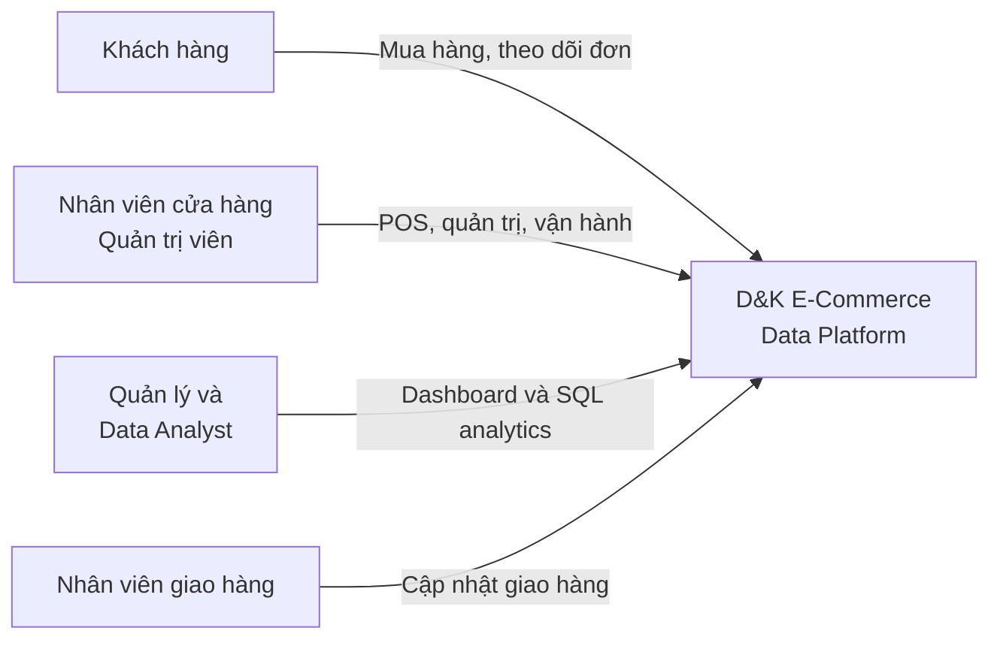
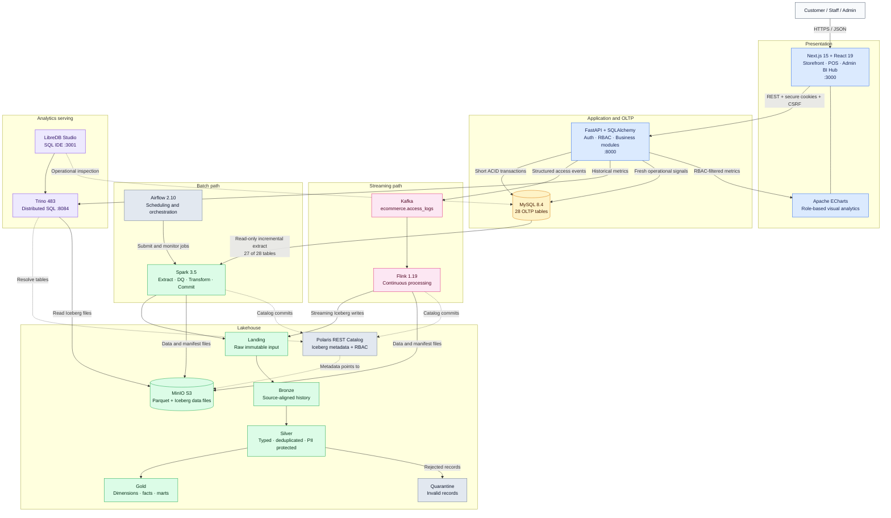
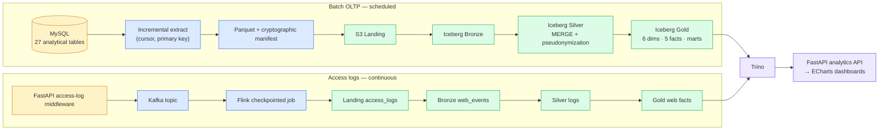
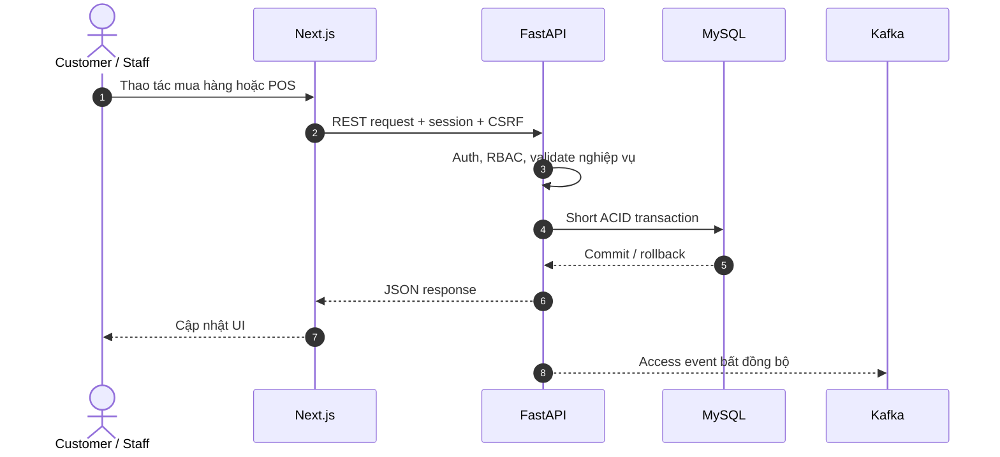
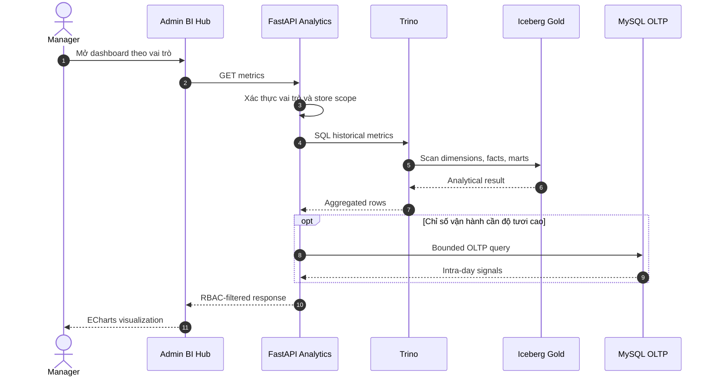
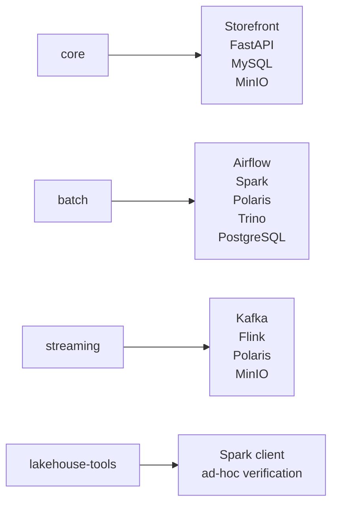

# System Architecture — Visual View

Tài liệu này trình bày kiến trúc triển khai hiện tại của D&K E-Commerce Data Platform. Phần ML không nằm trong phạm vi kiến trúc đang vận hành.

## 1. System context

## 2. Container architecture

### Ranh giới trách nhiệm

| Khối | Nguồn dữ liệu chính | Trách nhiệm | Không chịu trách nhiệm |
|---|---|---|---|
| Next.js | FastAPI | UI khách hàng, POS, admin, biểu đồ | Truy cập DB/Trino trực tiếp |
| FastAPI | MySQL, Trino | Nghiệp vụ, auth/RBAC, API analytics | Batch ETL, lưu trữ lịch sử phân tích |
| MySQL | Giao dịch ứng dụng | OLTP và invariant nghiệp vụ | Truy vấn phân tích lịch sử nặng |
| Kafka + Flink | Access events | Luồng log gần thời gian thực | Điều phối batch OLTP |
| Airflow + Spark | MySQL, Landing | Điều phối và xử lý Medallion batch | Phục vụ request người dùng |
| MinIO + Iceberg + Polaris | Data/metadata lakehouse | Lưu file, table format và catalog | Thực thi SQL phân tán |
| Trino | Iceberg Gold | Truy vấn phân tích | Ghi giao dịch OLTP |

## 3. Hai đường đưa dữ liệu vào Lakehouse

`customer_credentials` là bảng duy nhất bị loại khỏi batch extraction; dữ liệu xác thực không đi vào Lakehouse.

## 4. Luồng request quan trọng

### 4.1. Giao dịch mua hàng/POS

### 4.2. Dashboard quản trị

## 5. Deployment profiles

Các profile dùng chung `lakehouse-network`; PostgreSQL chỉ lưu metadata cho Polaris và Airflow, không chứa dữ liệu nghiệp vụ.

## 6. Quyết định kiến trúc cốt lõi

1. Giao dịch đi qua FastAPI và MySQL; không ghi thẳng vào Lakehouse.
2. Dashboard đi qua FastAPI để giữ RBAC và store-level filtering ở phía server.
3. Trino phục vụ số liệu lịch sử từ Gold; MySQL chỉ bổ sung tín hiệu vận hành cần độ tươi cao.
4. Spark là batch writer; Flink là streaming writer; cả hai commit Iceberg qua Polaris.
5. MinIO giữ data files, Polaris giữ metadata catalog, Trino chỉ thực thi truy vấn.
6. ML là pha tương lai và không nằm trên critical path của hệ thống hiện tại.
