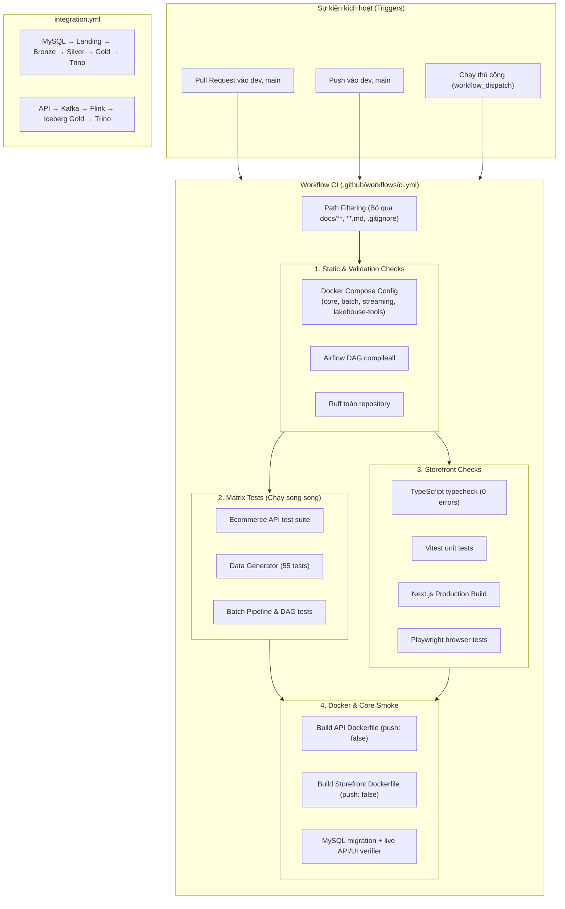

# CI & DataOps Runbook

Tài liệu này hướng dẫn chi tiết về kiến trúc, cấu hình và quy trình tự động hóa **CI (Continuous Integration)** và kiểm thử chất lượng mã nguồn (Quality Gate) của hệ thống **D&K E-Commerce Data Platform**.

---

## 1. Tổng quan Kiến trúc CI (Continuous Integration)

Hệ thống dùng hai GitHub Actions workflow: CI nhanh
([`.github/workflows/ci.yml`](../../.github/workflows/ci.yml)) cho pull request/push và
integration thật ([`.github/workflows/integration.yml`](../../.github/workflows/integration.yml))
cho `main`/`master`, lịch hằng tuần hoặc chạy thủ công.



---

## 2. Chi tiết các giai đoạn Kiểm thử Tích hợp (CI Jobs)

### 2.1. Bộ lọc đường dẫn (Path Filtering)
- **Tối ưu tài nguyên:** Khi commit chỉ chỉnh sửa tài liệu (`docs/**`, `**.md`, `.gitignore`, `LICENSE`), GitHub Actions sẽ **tự động bỏ qua** thực thi CI để tiết kiệm thời gian và hạn ngạch runner.

### 2.2. Kiểm tra tĩnh & Tính tương thích Hạ tầng (`repository-validation`)
1. **Docker Compose Validation:** Chạy `docker compose --env-file .env.example config --quiet` trên toàn bộ 4 profile hoạt động thực tế (`core`, `batch`, `streaming`, `lakehouse-tools`) để kiểm tra cấu trúc Compose và nội suy biến. Job đọc trực tiếp cấu hình dev trong `.env.example`, vì `.env` không được lưu trong Git; các credential MinIO bắt buộc vẫn được giữ nguyên trong Compose.
2. **Kiểm tra biên dịch Airflow DAG:** Chạy `python3 -m compileall -q airflow/dags/` để phát hiện ngay lập tức bất kỳ lỗi cú pháp Python nào trong các định nghĩa pipeline.
3. **Ruff Linter:** Chạy `uvx ruff check .` cho toàn bộ ruleset đã cấu hình của repository.

### 2.3. Kiểm thử song song theo Matrix (`python-tests`)
Để tối ưu hóa thời gian thực thi, các bộ test Python được phân tách thành ma trận chạy đồng thời trên 3 runner riêng biệt:
- **`Ecommerce API`:** Bộ test toàn diện nghiệp vụ OLTP, RBAC 7 vai trò, COGS snapshot, vòng đời đơn hàng và trả hàng/hoàn tiền.
- **`Data Generator`:** 55 bài test kiểm thử trình sinh dữ liệu giao dịch giả lập theo phân phối thị trường Việt Nam.
- **`Batch Pipeline & DAGs`:** Kiểm thử các tầng Medallion (Landing, Bronze, Silver, Gold), bảo trì Iceberg và tính toàn vẹn DAG (`pipelines/tests/test_dags.py`).

### 2.4. Kiểm tra mã nguồn giao diện (`storefront`)
- **ESLint:** kiểm tra quy ước và lỗi mã nguồn React/Next.js.
- **Vitest:** unit test API client, error contract và phân quyền/redirect theo role.
- **TypeScript Typecheck:** `npm run typecheck` (`tsc --noEmit`) kiểm tra strict type safety cho toàn bộ giao diện.
- **Next.js Production Build:** `npm run build` kiểm tra khả năng đóng gói Next.js standalone server phục vụ triển khai.
- **Playwright:** browser test luồng public home → catalog và bảo vệ return target đăng nhập.

### 2.5. Kiểm tra Docker và core stack
- Biên dịch thử nghiệm cả hai `Dockerfile` (`services/ecommerce-api/Dockerfile` và `apps/storefront/Dockerfile`) với tham số `push: false`.
- Tận dụng GitHub Actions Cache (`type=gha`) để tái sử dụng các tầng image (layer caching).
- Chạy migration tiến/lùi trên MySQL 8.4 thật, sau đó khởi động API/storefront và xác minh health, OpenAPI, auth và contract analytics degraded mode.

### 2.6. Integration workflow

- **Batch:** chạy catalog interoperability smoke test, trigger DAG Airflow và chỉ đạt khi
  `fact_order` cùng `mart_sales_daily` có dữ liệu đọc được từ Trino và batch audit mới nhất
  của cả `pre_gold_reconciliation` lẫn `post_gold` không có check thất bại.
- **Streaming:** phát request thật qua API và đối chiếu cùng `request_id` trong Kafka rồi
  `lakehouse.gold.fact_web_events` qua Trino.
- Workflow thu log khi lỗi và luôn xóa stack/volume sau khi chạy.

---

## 3. Các lệnh kiểm thử cục bộ trước khi đẩy code (Local Pre-push Commands)

Để đảm bảo commit chắc chắn vượt qua CI trên GitHub Actions, lập trình viên có thể chạy:

```bash
# Cách 1: Chạy qua Makefile
make test
make typecheck

# Cách 2: Chạy chi tiết từng bộ kiểm thử
# 1. Kiểm tra cú pháp Compose toàn bộ profiles
docker compose --env-file .env.example --profile core --profile batch --profile streaming --profile lakehouse-tools config --quiet

# 2. Kiểm tra cú pháp DAGs & Linter
python3 -m compileall -q airflow/dags/
uvx ruff check .

# 3. Chạy toàn bộ Unit Tests Python
uv run --locked --package ecommerce-api --extra dev -- pytest services/ecommerce-api/tests
uv run --locked --package data-generator --extra dev -- pytest generator/tests
PYTHONPATH=pipelines/src uv run --locked --package batch-pipeline --extra dev -- pytest pipelines/tests

# 4. Kiểm tra Storefront
npm --prefix apps/storefront run lint
npm --prefix apps/storefront test
npm --prefix apps/storefront run typecheck
npm --prefix apps/storefront run build
npm --prefix apps/storefront run test:e2e

# 5. Verifier theo tầng (sau khi stack tương ứng đã chạy)
./scripts/verify_core.sh
./scripts/lakehouse_smoke.sh
./scripts/verify_batch_pipeline.sh
./scripts/verify_streaming.sh
```
